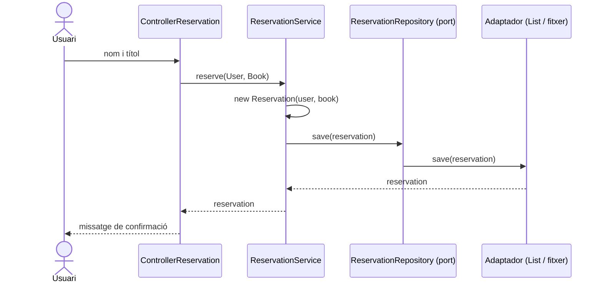

# Exercici: Aplicació de reserva de llibres de biblioteca (Arquitectura Hexagonal)

Crea una aplicació de consola en Java que permeti reservar llibres d'una biblioteca,
seguint l'**arquitectura hexagonal** (ports i adaptadors).

## Requisits funcionals

1. Un menú de consola repetitiu amb aquestes opcions:
   - `1. Nova reserva`
   - `2. Llista de reserves`
   - `0. Sortir`
2. **Nova reserva**: l'usuari introdueix el seu nom i el títol del llibre. L'aplicació mostra
   un missatge de confirmació amb el nom de l'usuari i el títol reservat
   (p. ex. `Reserva realitzada: Anna ha reservat "El Quixot"`).
3. L'usuari pot fer **més d'una reserva** sense reiniciar l'aplicació (el menú es repeteix fins que tria `0`).
4. **Llista de reserves**: mostra totes les reserves fetes (usuari i llibre).
5. Validacions mínimes: el nom i el títol no poden ser buits, i una opció de menú no vàlida
   (o no numèrica) ha de mostrar un missatge d'error sense aturar el programa.

## Requisits d'arquitectura

Organitza el codi en tres capes (paquets). **Les dependències sempre van cap al domini**:
`infraestructure → application → domain`.

| Paquet | Contingut | Responsabilitat |
|---|---|---|
| `domain` | `User`, `Book`, `Reservation`, `ReservationService` | Lògica de negoci. No depèn de cap altra capa ni de `Scanner`/`System.out`. |
| `application` | `ReservationRepository` (port de sortida), `ControllerReservation` | Defineix els ports i coordina el flux entre l'usuari i el domini. |
| `infraestructure.adapter` | `InMemoryReservationRepositoryAdapter`, `FileReservationRepositoryAdapter` | Implementen el port `ReservationRepository` (detalls tècnics). |

Detall de les classes:

- **`User`**: dades de l'usuari (nom). **`Book`**: dades del llibre (títol).
- **`Reservation`**: encapsula la reserva (un `User` i un `Book`) i en sobreescriu `toString()`.
- **`ReservationService`**: té el mètode `reserve(User, Book)` que crea la `Reservation` i la desa
  a través del port, i el mètode `getAllReservations()`. Rep el `ReservationRepository`
  pel **constructor** (injecció de dependències) i mai coneix quin adaptador s'utilitza.
- **`ReservationRepository`** (interfície): `save(Reservation)` i `findAll()`.
- **`ControllerReservation`**: demana les dades per consola, mostra el menú i crida el servei.
  Només fa entrada/sortida i delegació; no conté lògica de negoci.
- **Adaptadors** (cal implementar-ne dos):
  - `InMemoryReservationRepositoryAdapter`: desa les reserves en una `List`.
  - `FileReservationRepositoryAdapter`: desa les reserves en un fitxer de text (p. ex. `reservations.txt`,
    una reserva per línia, per exemple `nom;títol`). Ha de **recuperar** les reserves existents
    del fitxer en consultar-les amb `findAll()`, de manera que persisteixin entre execucions.
- **`MainReservationsApp`** (*composition root*): és l'únic lloc on es creen i es connecten
  les peces (adaptador → servei → controlador) i s'inicia l'aplicació.

## Prova de l'arquitectura

Canvia només **una línia** del `MainReservationsApp` (l'adaptador instanciat) per passar de
memòria a fitxer. Si has de tocar el servei, el controlador o el domini, l'arquitectura no és correcta.

## Diagrama

Flux d'una nova reserva:

