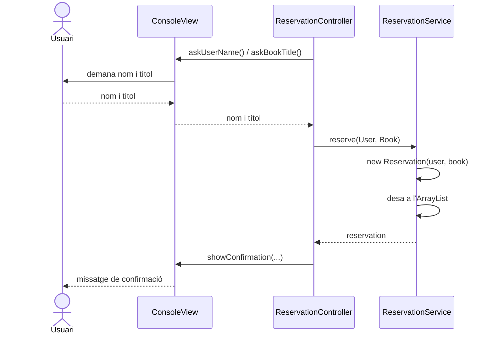

# Exercici: Aplicació de reserva de llibres de biblioteca (Arquitectura MVC)

Crea una aplicació de consola en Java que permeti reservar llibres d'una biblioteca,
seguint l'**arquitectura MVC** (Model-Vista-Controlador).

## Requisits funcionals

1. Un menú de consola repetitiu amb aquestes opcions:
   - `1. Nova reserva`
   - `2. Llista de reserves`
   - `0. Sortir`
2. **Nova reserva**: l'usuari introdueix el seu nom i el títol del llibre. L'aplicació mostra
   un missatge de confirmació amb el nom de l'usuari i el títol reservat
   (p. ex. `Reserva realitzada: Anna ha reservat "El Quixot"`).
3. L'usuari pot fer **més d'una reserva** sense reiniciar l'aplicació (el menú es repeteix fins que tria `0`).
4. **Llista de reserves**: mostra totes les reserves fetes (usuari i llibre).
5. Validacions mínimes: el nom i el títol no poden ser buits, i una opció de menú no vàlida
   (o no numèrica) ha de mostrar un missatge d'error sense aturar el programa.

## Requisits d'arquitectura

Organitza el codi en tres capes (paquets). **La vista i el model no es coneixen entre ells**:
el controlador és l'únic que els connecta (`view ← controller → model`).

| Paquet | Contingut | Responsabilitat |
|---|---|---|
| `model` | `User`, `Book`, `Reservation`, `ReservationService` | Dades i lògica de negoci. No depèn de la vista ni del controlador, ni de `Scanner`/`System.out`. |
| `view` | `ConsoleView` | Interacció amb l'usuari: només entrada i sortida per consola. |
| `controller` | `ReservationController` | Coordina el flux entre la vista i el model. |

Detall de les classes:

- **`User`**: dades de l'usuari (nom). **`Book`**: dades del llibre (títol).
- **`Reservation`**: encapsula la reserva (un `User` i un `Book`) i en sobreescriu `toString()`.
- **`ReservationService`**: té el mètode `reserve(User, Book)` que crea la `Reservation` i la desa en una **llista en memòria** (`ArrayList<Reservation>`, atribut del servei),
  i el mètode `getAllReservations()`, que retorna les reserves desades (les dades es perden en tancar l'aplicació).
- **`ConsoleView`**: mostra el menú, demana les dades per consola i mostra confirmacions,
  llistats i errors. No conté lògica de negoci.
- **`ReservationController`**: rep el `ReservationService` i la `ConsoleView` pel **constructor**,
  executa el bucle del menú, demana les dades a la vista i crida el servei.
  No fa entrada/sortida directa.
- **`MainMVC`**: és l'únic lloc on es creen i es connecten les peces
  (model → vista → controlador) i s'inicia l'aplicació.

## Reflexió

> Reflexiona: ara les reserves es desen en memòria (`ArrayList`). Si haguessis de desar-les en
> un fitxer o en una base de dades perquè persisteixin entre execucions, quines classes
> hauries de modificar? Afectaria la vista o el controlador? Quin inconvenient té que
> `ReservationService` barregi la lògica de negoci amb la manera de desar les dades?

## Diagrama

Flux d'una nova reserva:

